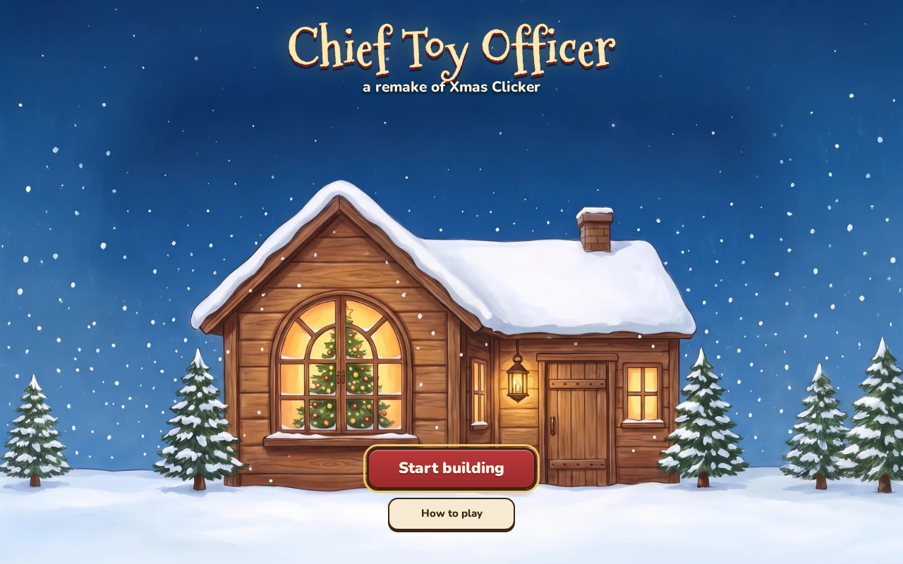
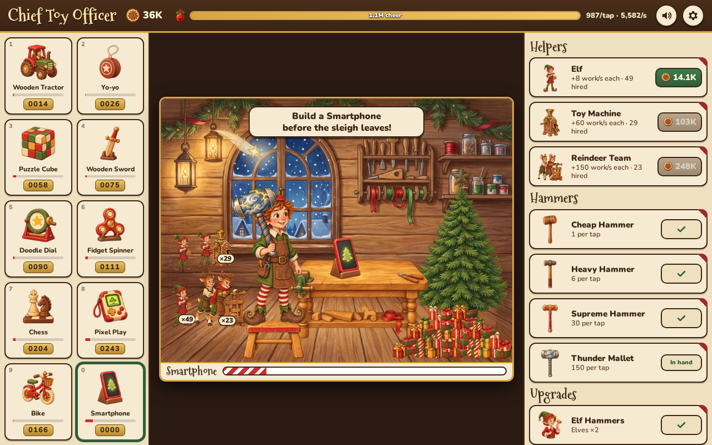
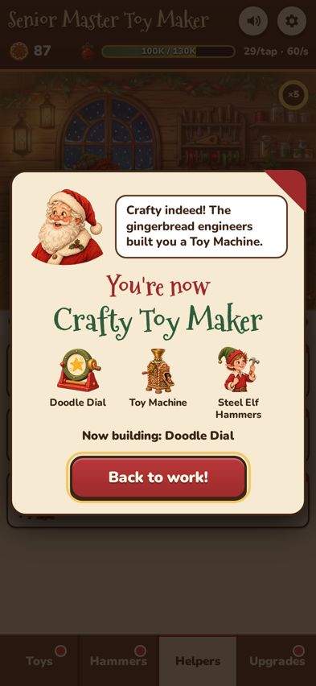
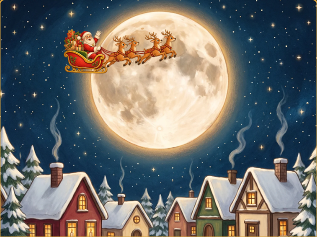
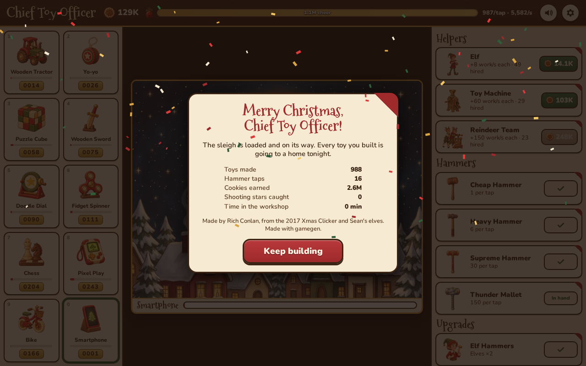

# Xmas Clicker

*Hammer your way from Assistant Junior Toy Maker to the top of Santa's workshop.*

You're the newest elf in Santa's workshop. Tap the bench to hammer toys
together, spend the cookies they earn on better hammers and more helpers, and
watch the presents pile up under the tree. Every promotion unlocks a new toy
and a sillier job title, until Santa names you Chief Toy Officer and you build
the last toy before the sleigh leaves on Christmas Eve.

**[▶ Play Xmas Clicker](https://xmasclicker.synapticnoise.com/)** in your browser. No
install, works on desktop and on phones.

## The workshop

| | |
|---|---|
|  |  |
| Ten toys, from the Wooden Tractor to the Smartphone, four hammers, elves, clockwork Toy Machines and a Reindeer Team. | Ten ranks, word for word from the original, each announced by Santa himself, and the little snow globe on the shelf shakes for every one. |
|  |  |
| Christmas Eve: the tree lights up, the presents float away, and the sleigh crosses the moon. | Then keep building as long as you like. |

## How to play

- **Hammer:** tap or click the stage, or press Space or Enter. Several fingers count.
- **Pick a toy:** tap its card (on phones, on the Toys tab), or press 1–9 and 0.
- **Buy:** tap a hammer, helper or upgrade when you have the cookies.
- **Elves:** the workshop only has room for so many: 4 at first, more with each promotion, and no limit once you're Chief Toy Officer.
- **Shooting stars:** from Pretty Good Toy Maker on, catch one in the window for a 20-second Star Rush.
- **Pause and settings:** Esc or P, or the gear button. **Mute:** M, or the speaker button.
- On a phone, hold it either way up. You can install it from your browser's menu to play full screen, even offline.
- Found a bug? Pause and pick "Report a bug", or press Ctrl+Shift+F (you'll need a GitHub account).

There's no way to lose. Your helpers keep working while you're away, and
everything is saved in your browser as you play. About 25 minutes of play take
you from your first tap to Christmas Eve.

## How it was made

Xmas Clicker was made by [Claude Code](https://claude.com/claude-code) with
[gamegen](https://github.com/zeveck/gamegen), from this request:

> `/gamegen --remake https://synapticnoise.com/xmasclicker --plan-only --share-design --leeway lots`

gamegen studied the 2017 original, kept its toys, its ten rank titles and its
zero-padded counters, finished what it was reaching for (hammers you can buy,
toys that earn something, Sean Dailey's elves, a tree and a pile of toys that fill
up), and wrote a plan, which was shared on the plans page and approved. Then,
to build it:

> `/gamegen:gamegen --continue --out xmas-clicker --budget 30 --art-sheet --publish --no-confirm`

(with a "Report a bug" button added along the way, from `--feedback`).

Then, to take the "remake" line off the title:

> `/gamegen:gamegen --change --out xmas-clicker Chief Toy Officer game shouldn't say "A remake of Xmas clicker" anywhere.`

To turn the Heavy Hammer the right way round, make the pile under the tree out of the toys you build, and credit Sean Dailey:

> `/gamegen:gamegen --out xmas-clicker --change The heavy hammer looks backwards. It'd be nice if the things I made actually piled up under the tree maybe? The credits should day "Sean Dailey's" instead of just "Sean's"  --publish --no-confirm`

And to fix the first player report, [#1 "Elves"](https://github.com/zeveck/xmas-clicker/issues/1) (hiring elves crowded out the hammers, so the workshop now has room for more elves with each rank):

> `/gamegen:gamegen --fix all --publish --no-confirm`

And to take back the original's name, Xmas Clicker, and leave the elf unnamed (the elf is simply you):

> `/gamegen:gamegen --change rename the game Xmas Clicker and leave the elf unnamed: say "you" instead of Pip --publish --no-confirm`

And to put a little snow globe on the shelf that shakes when you get promoted:

> `/gamegen --out xmas-clicker --change add a little snow globe on the shelf that shakes when you get promoted`

gamegen had review agents polish the design, made the art, animation, music and
sound with these plugins, built it, and play-tested it:

- [imagegen2](https://github.com/zeveck/imagegen2): the elf, every toy, hammer, helper, upgrade and present, Santa, the bench, the tree, the stool, the snow globe and the sleigh
- [nanogen](https://github.com/zeveck/nanogen): the workshop, the title art and the moonlit sky of Christmas Eve
- [anim8gen](https://github.com/zeveck/anim8gen): the elf's hammer swing
- [audiogen](https://github.com/zeveck/audiogen): the workshop music, the Christmas Eve music, 18 sound effects and Santa's "Ho ho ho"

## Replaying the tests

- `node tools/balance.mjs` plays the whole game in a simulation, with the game's own rules, and checks the pacing (every rank within 25% of its target time, never more than 90 seconds between purchases, a slow player reaching Christmas Eve in under 45 minutes) and the rules for time away. It also writes the saves the play-test starts each rank from.
- `tools/play-rank.js` plays the real game in a browser with real taps and clicks, from any rank to the next, or from a fresh start to Christmas Eve. Serve the `game` folder, open it with `?debug` in [playwright-cli](https://github.com/microsoft/playwright-cli), and run, for example, `playwright-cli run-code "$(sed -e 's/__FROM__/3/' -e 's/__TO__/4/' -e 's/__LIMIT__/400/' tools/play-rank.js)"`. The results of the last run are in `design/solutions/`.

## Playing locally

Xmas Clicker is a plain web page with no build step. Serve the `game`
folder with any static web server, for example:

    cd game
    python3 -m http.server 8000

then open http://localhost:8000.

## Credits

- An idea by Rich Conlan, from the 2017 game of the same name and Sean Dailey's elf prototype.
- Fonts: [Mountains of Christmas](https://fonts.google.com/specimen/Mountains+of+Christmas) by Tart Workshop (Apache License 2.0) and [Nunito](https://fonts.google.com/specimen/Nunito) by Vernon Adams and others (SIL Open Font License 1.1). Their licenses are in `game/fonts/`.
